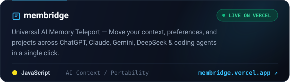
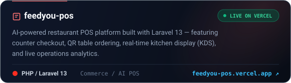
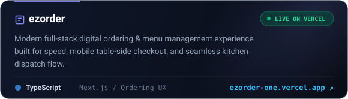
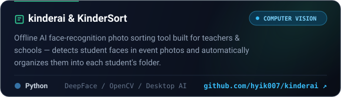

 

  
  
  
  
  
  
  

---

### `whoami`

| Focus Area | What I Build |
| :--- | :--- |
| **AI Systems & Portability** | Cross-model context teleportation, agent workflows, and practical LLM tooling |
| **Full-Stack Web & Commerce** | End-to-end restaurant POS platforms, real-time KDS, and QR table ordering |
| **Applied Computer Vision** | Offline desktop recognition tools built for speed, privacy, and everyday teams |
| **Engineering Ethos** | Ship fast, keep interfaces calm, and let clean architecture do the heavy lifting |

---

### Featured Projects

<table>
  <tr>
    <td width="50%" align="center">
      
       
      <a href="https://membridge.vercel.app"><strong>Live App ↗</strong></a> &nbsp;•&nbsp;
      <a href="https://github.com/hyik007/membridge">Source Code ↗</a>
    </td>
    <td width="50%" align="center">
      
       
      <a href="https://feedyou-pos.vercel.app"><strong>Live App ↗</strong></a> &nbsp;•&nbsp;
      <a href="https://github.com/hyik007/feedyou-pos">Source Code ↗</a>
    </td>
  </tr>
  <tr>
    <td width="50%" align="center">
      
       
      <a href="https://ezorder-one.vercel.app"><strong>Live App ↗</strong></a> &nbsp;•&nbsp;
      <a href="https://github.com/hyik007/ezorder">Source Code ↗</a>
    </td>
    <td width="50%" align="center">
      
       
      <a href="https://github.com/hyik007/KinderSort"><strong>KinderSort ↗</strong></a> &nbsp;•&nbsp;
      <a href="https://github.com/hyik007/kinderai">KinderAI Repo ↗</a>
    </td>
  </tr>
</table>

---

### Tech Stack & Toolkit

**Languages & Core**
  
<picture>
  <source media="(prefers-color-scheme: dark)" srcset="https://skillicons.dev/icons?i=ts,js,py,php,html,css,postgres,bash&theme=dark" />
  <source media="(prefers-color-scheme: light)" srcset="https://skillicons.dev/icons?i=ts,js,py,php,html,css,postgres,bash&theme=light" />
  
</picture>

  

**Frameworks & AI**
  
<picture>
  <source media="(prefers-color-scheme: dark)" srcset="https://skillicons.dev/icons?i=nextjs,react,nodejs,laravel,tailwind,fastapi,pytorch,opencv&theme=dark" />
  <source media="(prefers-color-scheme: light)" srcset="https://skillicons.dev/icons?i=nextjs,react,nodejs,laravel,tailwind,fastapi,pytorch,opencv&theme=light" />
  
</picture>

  

**Cloud, Data & DevOps**
  
<picture>
  <source media="(prefers-color-scheme: dark)" srcset="https://skillicons.dev/icons?i=vercel,docker,git,github,githubactions,mysql,sqlite,linux&theme=dark" />
  <source media="(prefers-color-scheme: light)" srcset="https://skillicons.dev/icons?i=vercel,docker,git,github,githubactions,mysql,sqlite,linux&theme=light" />
  
</picture>

---

### GitHub Activity & Contribution Snake

<picture>
  <source media="(prefers-color-scheme: dark)" srcset="https://streak-stats.demolab.com?user=hyik007&theme=tokyonight&hide_border=true&background=0D1117&ring=38BDF8&fire=38BDF8&currStreakLabel=38BDF8" />
  <source media="(prefers-color-scheme: light)" srcset="https://streak-stats.demolab.com?user=hyik007&theme=default&hide_border=true&ring=0284C7&fire=0284C7&currStreakLabel=0284C7" />
  
</picture>

  

<picture>
  <source media="(prefers-color-scheme: dark)" srcset="./dist/github-contribution-grid-snake-dark.svg" />
  <source media="(prefers-color-scheme: light)" srcset="./dist/github-contribution-grid-snake.svg" />
  
</picture>

---

  Noot Noot 🐧 • Crafted by Hong Yik (<a href="https://github.com/hyik007">@hyik007</a>)

